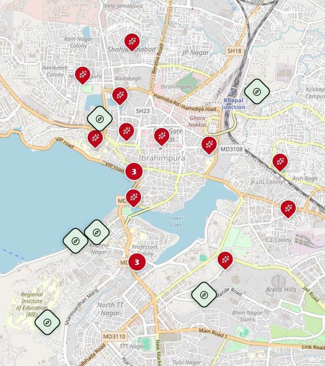
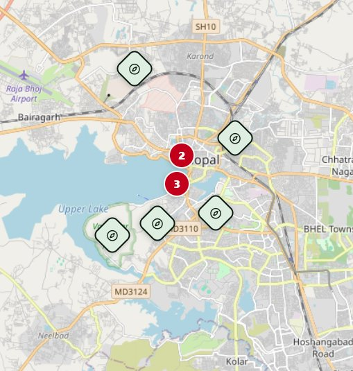

# Voyeger — Hybrid(offline+online) Cultural & Local Discovery Platform (Bhopal)

**Voyeger** is an offline-first, multilingual web application that helps travellers discover lesser-known heritage sites, local kitchens, cultural spaces, and neighbourhood experiences around Bhopal — even without connectivity.

---

## Table of Contents

1. [Problem Statement](#problem-statement)
2. [Proposed Solution](#proposed-solution)
3. [Core Features](#core-features)
4. [Screenshots & Proof](#screenshots--proof)
5. [Repository Structure](#repository-structure)
6. [System Architecture](#system-architecture)
7. [Technology Stack](#technology-stack)
8. [Getting Started (One-Command Launcher)](#getting-started-one-command-launcher)
9. [Environment Configuration](#environment-configuration)
10. [Offline-First Architecture](#offline-first-architecture)
11. [Known Limitations & Future Scope](#known-limitations--future-scope)
12. [Licensing Note](#licensing-note)
13. [Team & Contributors](#team--contributors)

---

## Problem Statement

Visitors exploring heritage-rich cities often rely on cloud-only map apps that:
- Fail in low-connectivity precincts, lakeside zones, and old-city lanes.
- Prioritize commercial listings over local stepwells, oral histories, artisans, and small eateries.
- Lack bilingual navigation (English / Hindi), travel phrases, and sensitivity cues for sacred spaces.

---

## Proposed Solution

Voyeger pairs an installable offline-first PWA (**frontend/**) backed by IndexedDB (`Dexie`) with a versioned content-pack & delta FastAPI server (**backend/**) and YAML curation pipeline:
- Travellers download a lightweight city pack once and browse maps, search, itineraries, and stories offline.
- Editorial records (`backend/content/places/*.yaml`) preserve curated narratives, provenance URLs, and sensitivity indicators without being overwritten by third-party feeds.

---

## Core Features

- **City Welcome (`/`)** — Dynamic city branding, opt-in geolocation, and local exploration stats (XP, hidden gems) stored in IndexedDB.
- **Map Explorer (`/discover`)** — MapLibre GL JS canvas with PMTiles vector archives and OSM raster fallback, category filters, zoom-based marker hierarchy, and nearby nudges.
- **Place Pages (`/place/:slug`)** — Bilingual stories, visitor facts, local tips, sacred-site badges, photo galleries, per-place colour themes, and discovery XP.
- **Multilingual & Phrasebook** — English/Hindi interface + 5-language offline travel phrasebook with transliteration.
- **Search & Day Planner** — Client-side MiniSearch + haversine walking itinerary builder.
- **Saved, Partners, Settings & Attribution** — Bookmarks, offline-queued forms, pack management, and provenance attributions.

---

## Screenshots & Proof

| Welcome Screen | Map Explorer (Markers & Place Popup) |
| :---: | :---: |
|  |  |

| Map — Zoomed In (All Categories) | Map — Zoomed Out (Clusters) |
| :---: | :---: |
|  |  |

| Settings & Offline Pack | Local Partners |
| :---: | :---: |
|  |  |

---

## Repository Structure

```text
voyeger-submission/
├── run.py            # Cross-platform single-command launcher
├── README.md
├── .gitignore
├── backend/          # FastAPI API, SQLAlchemy/Alembic DB, YAML content & pack pipeline, pytest suite
├── frontend/         # TanStack Start + React + Vite PWA, Dexie offline store, MapLibre UI, Vitest suite
├── docs/             # Architecture and setup notes
└── proofs/           # App screenshots used in this README
```

---

## System Architecture

```text
Curated YAML (backend/content/places/*.yaml)
   │  pipeline.validate + pipeline.build_pack
   ▼
SQLite / SQLAlchemy DB + Versioned Pack Artifacts (pack/v{N}/places.json, delta_*.json, images/*.webp)
   │  FastAPI HTTP + Range Static Server (:8000)
   ├── GET  /api/manifest                GET  /api/health
   ├── GET  /api/delta?from=N&to=M       GET  /api/enrichment?place_ids=...
   └── POST /api/events  /api/partners/apply  /api/enquiries
   │
   ▼  ApiClient (HttpApi or standalone MockApi)
Frontend IndexedDB via Dexie (voyeger-bhopal)
   │  places, partners, text, media_meta, meta, outbox, saved, events, discoveries
   ▼  src/data/repo.ts (single read boundary)
TanStack Router Views (Welcome, Discover Map, Search, Planner, Place Detail, Saved, Partners, Settings)
```

See [docs/ARCHITECTURE.md](docs/ARCHITECTURE.md) and [backend/docs/API_CONTRACT.md](backend/docs/API_CONTRACT.md) for deeper notes.

---

## Technology Stack

| Layer | Technologies |
| --- | --- |
| **Frontend** | React 19, TypeScript 5.8, Vite 8, TanStack Start / Router / Query, Tailwind CSS v4, Radix UI, Lucide React |
| **Offline & Map** | Dexie (IndexedDB), MiniSearch, MapLibre GL JS, PMTiles, Workbox (`vite-plugin-pwa`), i18next |
| **Backend API** | Python 3, FastAPI, Uvicorn, SQLAlchemy 2, Alembic, Pydantic 2 |
| **Content Pipeline** | PyYAML, Pillow, httpx |
| **Testing** | Vitest, React Testing Library, fake-indexeddb, jsdom; pytest |

---

## Getting Started (One-Command Launcher)

### Prerequisites

| Tool | Minimum Version | Install |
| --- | --- | --- |
| **Python** | 3.11+ | https://www.python.org/downloads/ |
| **Node.js** | 20+ (includes npm) | https://nodejs.org/ |
| **Git** | Any recent version | https://git-scm.com/ |

### Clone & Run

```bash
git clone https://github.com/hottymithaulia/voyeger.git
cd voyeger
python run.py
```

That single command will:
1. ✅ Verify Python, Node.js, and npm are installed.
2. 📦 Create a virtual environment and install backend dependencies.
3. 🗄️ Initialize the SQLite database (`alembic upgrade head`), ingest 28 curated places, and build the content pack.
4. 📥 Install frontend dependencies (`npm ci --legacy-peer-deps`).
5. 🧪 Run backend tests (pytest), TypeScript check, and frontend tests (Vitest).
6. 🏗️ Run the production build (`vite build`).
7. 🚀 Start both servers — **Backend** on `http://localhost:8000` and **Frontend** on `http://localhost:8080`.

### Launcher Flags

| Command | What It Does |
| --- | --- |
| `python run.py` | Full flow: setup → test → build → start servers |
| `python run.py --check` | Inspect prerequisites and configuration (read-only) |
| `python run.py --setup` | Install dependencies and initialize .env / DB / pack (no server start) |
| `python run.py --test` | Run all backend and frontend tests + TypeScript validation |
| `python run.py --build` | Run frontend production build only |
| `python run.py --no-tests` | Skip tests/build and start both servers directly |

> **Tip:** If pre-existing frontend test failures prevent `python run.py` from launching, use `python run.py --no-tests` to start the servers immediately.

### Manual Setup (Alternative)

Detailed step-by-step instructions (Windows PowerShell & macOS/Linux) are in [docs/SETUP.md](docs/SETUP.md).

---

## Environment Configuration

Real `.env` files are excluded from the repository. `python run.py --setup` creates them automatically from the `.env.example` templates.

### Backend (`backend/.env.example` → `backend/.env`)
- `DATABASE_URL=sqlite:///./voyeger.db`
- `CORS_ORIGINS=http://localhost:5173,http://127.0.0.1:5173,http://localhost:8080`
- `PACK_DIR=./pack`, `TILES_DIR=./tiles`, `PUBLIC_BASE_URL=http://localhost:8000`
- `ADMIN_TOKEN=change-me` (replace before non-local use)

### Frontend (`frontend/.env.example` → `frontend/.env`)
- **Mock Mode** (no backend): `VITE_API_MODE=mock`
- **Connected Mode** (full stack): `VITE_API_MODE=http`, `VITE_API_BASE_URL=http://localhost:8000`

---

## Offline-First Architecture

1. **Single Client Read Boundary** — All UI reads from IndexedDB via `src/data/repo.ts`; API responses populate IndexedDB via `src/data/sync.ts`.
2. **Versioned Pack & Delta Sync** — First run downloads full pack; subsequent updates fetch `/api/delta?from=N&to=M` patches (gaps > 5 trigger full resync).
3. **Curated-Over-Enrichment** — Third-party metadata stays under `place.enrichment` and never overwrites curated content.
4. **Offline Outbox** — Partner applications, enquiries, and events queue in Dexie `outbox` and flush when online.

---

## Known Limitations & Future Scope

- **Draft Coordinates & Media** — 27 research places carry `status: draft` with nullable coordinates and placeholder images; frontend gracefully hides affected UI.
- **Empty Live Partners** — `partners.json` is empty until partner records are approved; mock packs include samples for UI testing.
- **PMTiles Archive** — `bhopal.pmtiles` is not checked in; MapLibre falls back to online OSM raster tiles when absent.
- **Local-Only XP** — Discovery XP is stored in Dexie, not synced to accounts.
- **License Pending** — No `LICENSE` file yet; content sources retain their attributed licenses (CC BY-SA 4.0, ODbL).

---

## Licensing Note

No `LICENSE` file is included because project-wide licensing has not been selected. Content source references retain their attributed open licenses.

---

## Team & Contributors

- `[Contributor 1 Name]` — `[Role, e.g., Frontend / Offline Architecture]`
- `[Contributor 2 Name]` — `[Role, e.g., Backend API / Content Pipeline]`
- `[Contributor 3 Name]` — `[Role, e.g., Research & Curation]`
